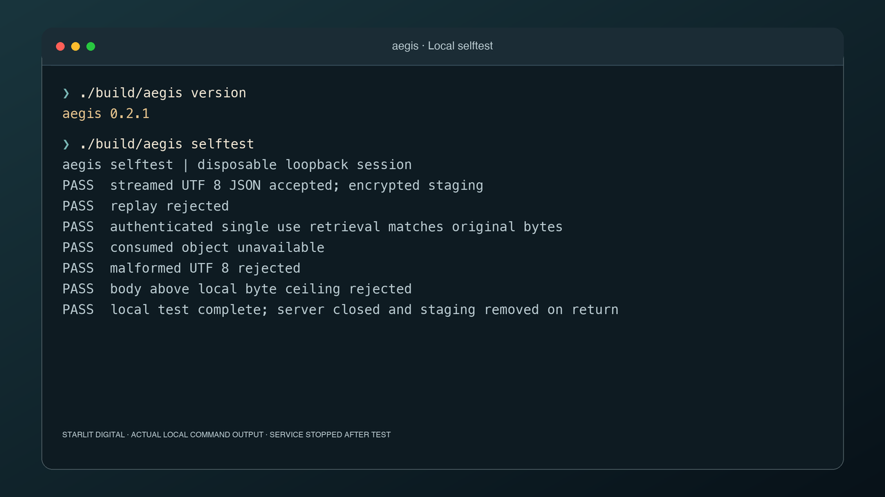

# Aegis

A small Go upload guardian with a strict local policy and encrypted ephemeral staging.

Version **0.1.0**. Early development, tested on macOS and in Linux CI, with Linux cross compilation checked locally. Aegis is dormant and has no application integration or enabled production deployment.



Aegis separates receiving untrusted bytes from an application's authorization and business operations. It accepts a short signed grant, measures the actual stream, validates JSON when that format is selected, and stages encrypted bytes outside the web root. A separate grant permits one retrieval by the same user and purpose. An opaque object identifier is never a public download URL.

## Build and try it

Requires Go 1.27.3, Make and Python 3. The optional PHP interoperability test requires PHP with cURL.

```sh
make compile
./build/aegis version
./build/aegis selftest
make verify
python3 scripts/smoke.py
```

`selftest` runs an actual loopback HTTP server with disposable keys, then shuts it down and removes staging. `smoke.py` exercises the built service through the dormant PHP adapter, tests a stalled upload, and verifies shutdown. Neither enables or modifies an application.

`make build` and `make install` install the CLI into `~/.local/bin` and record the source checkout, commit, dirty state and binary SHA256 in `~/.local/share/aegis/install-info.json`. Installation does not start the service. Use `make compile` to leave installed tools untouched.

## Local policy

Every policy value is read from a local JSON file once at startup. There is no HTTP administration endpoint, remote configuration, live reload or request controlled resource policy. Configuration can lower the compiled ceilings, never raise them. Unknown configuration fields fail startup.

| Boundary | Default and compiled maximum |
| --- | --- |
| Actual request bytes | 1 MiB |
| Concurrent operations | 2 |
| Accepted TCP connections | 32 |
| Requests admitted | 16 per second globally |
| Staged objects | 16 globally, 2 per subject |
| JSON depth | 16 |
| JSON tokens | 10,000 |
| Decoded JSON string | 4,096 UTF 8 bytes |
| JSON number spelling | 128 bytes |
| Ticket lifetime | 60 seconds, adapter issues 30 seconds |
| Staged retention | 300 seconds |
| Request read and write deadline | 15 seconds |
| Header deadline | 3 seconds |
| Idle connection deadline | 5 seconds, keep alive disabled |
| HTTP header budget | Go MaxHeaderBytes 4 KiB, plus transport parser allowance |
| Application header fields | 32, singleton values only |
| Go managed memory target | 32 MiB, a soft runtime limit |
| Linux OS memory template | 96 MiB hard cap, swap disabled |

Go's managed memory target is not an RSS guarantee. The supplied Linux service template adds cgroup memory, CPU, task and file descriptor caps. The macOS test does not claim to reproduce Linux cgroup enforcement. Stream buffers are bounded, but an individual JSON token may allocate up to the body cap before the stricter token validation rejects it.

There are no caller supplied filenames, storage paths, redirect destinations or download URLs. Staging uses random private file names, a private directory with one process owner, AES 256 GCM chunks with separately derived keys per user, purpose and object, bound to chunk order, and a SHA256 receipt. Temporary files are removed after rejection, expiry, retrieval or graceful shutdown. Startup removes abandoned session directories under the exclusive spool lock. A bounded replay ledger retains spent grant IDs until expiry across restarts; these small records contain no payload or user identity. A crash can leave encrypted bytes until the next startup or an operator removes the dedicated spool. Storage is not durable import history.

## HTTP contract

The only path is `/v1/uploads`. Query strings, alternate paths and trailers are rejected. `PUT` uploads, `GET` consumes once, and `DELETE` discards an existing object. A signed `Authorization: Bearer` ticket contains exactly `purpose`, `aud`, `id`, `sub`, `op` and `exp`. The audience is `aegis-staging-v1`. The default local purpose is `account-import`.

The ticket grants an operation and identity. It cannot choose quotas, storage, timeouts or parser limits. The issuer generates a random 128 bit identifier and derives the subject from an authenticated application session. Read grants remain on the application server. Authorization is checked before body processing. Upload attempts burn their grant even when parsing fails; issue a fresh identifier to retry. Retrieval is consumed even if the recipient disconnects. All replicas must share the same ownership authority or use independent grants and spools; this first version deliberately supports one local process.

The default local policy accepts only `application/json`, optionally with `charset=utf-8`. An operator can instead configure a separate opaque binary instance with `content_type: application/octet-stream`; a request cannot switch off JSON validation by choosing a different header. Other media types, multipart, content encodings, trailers and duplicated application headers are rejected. JSON requires valid UTF 8, correctly paired escaped surrogates, unique object keys, bounded depth and tokens, and a single complete value. Unicode is preserved, not converted to ASCII. Opaque binary bytes are not treated as text or declared safe content. No archive, image, office document or executable parser runs.

`Content-Length` is an early rejection hint, never the byte authority. Chunked requests still pass through the same actual byte limit. Aegis rejects forwarded identity headers and ignores request headers purporting to change its limits. A future proxy must strip forwarded headers and must not buffer large bodies in PHP. Aegis never uses proxy headers to identify a user, select a filesystem destination, determine a trusted scheme or relax policy. Explicit browser Origins must match the local list; the default accepts no Origin. There is no permissive CORS response.

Successful upload responses contain an ID, byte count, SHA256 and expiry. They never contain a storage path. Unknown or differently owned IDs return the same 404. Responses use no store caching and a restrictive content security policy. Logs do not include tickets, payloads or uploaded names.

## Deliberately dormant deployment

`config/aegis.example.json` has `enabled: false`. `aegis check --config FILE` validates local configuration without opening a listener. `serve` refuses disabled configuration. There is no automatic launch agent, application include, reverse proxy route, scheduled task or enabled systemd unit. The reference unit has no Install section.

A future deployment needs a dedicated unprivileged user, a dedicated private spool outside every web root, two distinct 32 byte keys in private files, a patched Go toolchain, and a reviewed proxy and application integration. PHP receives only the ticket signing key, never the storage key or permission to read the spool. `integrations/php/AegisStagingClient.php` is an explicitly loaded reference adapter with a fixed loopback address, no redirects, no proxy, a response size cap and SHA256 verification. It registers no routes.

See [integration boundaries](docs/INTEGRATION.md), [security model](SECURITY.md), [future adoption](docs/ADOPTION.md) and [test evidence](docs/TESTING.md).

## Scope

Aegis is a constrained staging service, not a malware scanner, a public file server, a domain schema validator or a replacement for application authorization. The application must still validate records, confirm sensitive operations, encrypt business data and commit atomically. A valid JSON document is not automatically a valid account import. Existing PHP installations still require the complete PHP2Shell runtime patches.

Source is available under [0BSD](LICENSE).
