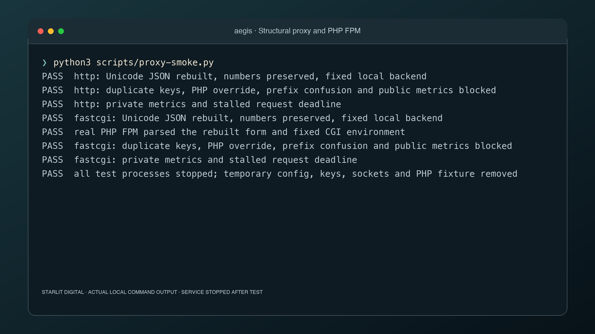

# aegis

A Go request guardian for PHP applications, with structural request normalization, fixed local backends and encrypted private upload staging.

Version **0.2.1**. An active open source project. Both example configurations start with `enabled: false`. Building or installing aegis does not change your application or web server.



aegis separates receiving untrusted bytes from an application's authorization and business operations. It accepts a short signed grant, measures the actual stream, validates JSON when that format is selected, and stages encrypted bytes outside the web root. A separate grant permits one retrieval by the same user and purpose. An opaque object identifier is never a public download URL.

## The name

The name comes from the [aegis of Greek mythology](https://en.wikipedia.org/wiki/Aegis), associated with Zeus and Athena and often described as a shield or protective covering. Its later meaning of protection inspired this project’s name.

## Choose a use case

| Use case | Mode | Practical behavior |
| --- | --- | --- |
| Protect a PHP JSON API boundary | `proxy` | Validate JSON structure and Unicode, reject duplicate keys, rebuild JSON, then forward to a fixed PHP front controller. |
| Accept ordinary browser form fields | `proxy` | Decode and validate names and values, then generate a canonical form body. |
| Accept multipart text fields without PHP multipart parsing | `proxy` | Parse bounded text parts in Go and forward a URL encoded form. File parts are rejected. |
| Put a normalization boundary before another local application | `proxy` with `protocol: http` | Forward to an HTTP server listening on a locally configured Unix socket. |
| Import account JSON without PHP handling upload transport | `staging`, the default | Stream validated bytes into private encrypted staging, then consume once using a separately authorized server grant. |
| Receive an opaque binary object | A separate `staging` instance | Select `application/octet-stream` in local config. Bytes remain untrusted until an application validates them. |
| Observe a proxy instance | Optional separate monitoring listener | Authenticated health and Prometheus counters without URLs, identities, payloads or configuration writes. |
| Review web server integration | `plan` command | Print nginx, Apache or Caddy examples without changing files or starting listeners. |

A process runs one mode. Use separate processes, ports and accounts if you need both boundaries. The proxy account must not have staging spool or storage key access. Proxy mode never exposes staging retrieval or monitoring through its public handler.

```text
Client → TLS web server → aegis proxy → fixed Unix socket → PHP front controller
Client → authorized upload route → aegis staging → encrypted private spool
Application → separate authorized read grant → aegis staging → application validation
```

## Build and try it

Requires Go 1.27.3, Make and Python 3. The optional PHP interoperability test requires PHP with cURL.

```sh
make compile
./build/aegis version
./build/aegis selftest
make verify
python3 scripts/smoke.py
python3 scripts/proxy-smoke.py
```

`selftest` runs an actual loopback HTTP server with disposable keys, then shuts it down and removes staging. `smoke.py` exercises the built service through the reference PHP adapter, tests a stalled upload, and verifies shutdown. Neither enables or modifies an application.

Tagged prereleases also provide CI built Linux and macOS binaries for amd64 and arm64, plus `SHA256SUMS`, on the [release page](https://github.com/Starlit-Digital/aegis/releases). Download the matching binary and verify its SHA256 before running it. Release binaries require no Go installation. For example, after downloading the macOS arm64 artifact:

```sh
shasum -a 256 aegis-darwin-arm64
# Compare with its exact entry in SHA256SUMS.
chmod 0755 aegis-darwin-arm64
./aegis-darwin-arm64 version
./aegis-darwin-arm64 selftest
```

`make build` and `make install` install the CLI into `~/.local/bin` and record the source checkout, commit, dirty state and binary SHA256 in `~/.local/share/aegis/install-info.json`. Installation does not start the service. Use `make compile` to leave installed tools untouched.

## Run a PHP API proxy

Patch PHP first. Choose the exact front controller and socket for your own application. The example assumes a PHP FPM pool reachable at `/run/php/app.sock`, with `/srv/app/public/index.php` as its entry point. Configure the pool socket owner and group to allow only aegis to connect. Keep the pool off public TCP listeners.

```sh
cp config/aegis.proxy.example.json /tmp/aegis-proxy.json
./build/aegis check --config /tmp/aegis-proxy.json
./build/aegis plan --config /tmp/aegis-proxy.json --server nginx
```

Edit that local copy to set the real `hosts`, `socket`, `server_name`, `document_root`, `script_filename` and `script_name`. `server_port` and `https` describe the deployment as configured by its administrator. A request header cannot override them. Change `enabled` to `true` in your copy when ready to run it:

```sh
./build/aegis serve --config /tmp/aegis-proxy.json
```

In another terminal, with the example host and a working backend:

```sh
curl --noproxy '*' --http1.1 http://127.0.0.1:8099/api/profile \
  -H 'Host: app.example.com' \
  -H 'Content-Type: application/json' \
  --data-binary '{ "display_name": "雪", "active": true }'

curl --noproxy '*' http://127.0.0.1:8099/api/preferences \
  -H 'Host: app.example.com' \
  --data-urlencode 'display_name=雪' --data-urlencode 'theme=dark'

curl --noproxy '*' http://127.0.0.1:8099/api/preferences \
  -H 'Host: app.example.com' -F 'display_name=雪' -F 'theme=dark'
```

The last request becomes an ordinary URL encoded body before reaching PHP. `curl -F 'file=@document.json'` is rejected. Use the staging flow below for files. An unknown host, disallowed method, unknown route, malformed body or conflicting query and form key never reaches the backend. Stop the foreground process with Control C.

Routes use the longest matching path prefix at a segment boundary. `/api` covers `/api` and `/api/profile`, but does not cover `/apievil`. Each route has its own explicit `methods`, `formats`, fixed backend and, for FastCGI, fixed front controller. Narrow routes can limit formats to `["json"]` or methods to `["POST"]`. Empty lists fail startup. General size and timing limits apply to the process and can only be lowered locally. The proxy settings `max_depth`, `max_tokens` and `max_string_bytes` lower the JSON parser ceilings. Query and form field budgets remain fixed compiled limits.

For an existing HTTP application on a private Unix socket, replace the route with:

```json
{
  "prefix": "/api",
  "protocol": "http",
  "socket": "/run/myapp/http.sock",
  "server_name": "app.example.com",
  "methods": ["GET", "POST"],
  "formats": ["none", "json", "form"]
}
```

Remove the FastCGI specific fields from that route. aegis never follows redirects, retries a backend request, performs DNS lookup for the backend, or uses an environment proxy.

### Proxy compatibility rules

These rules are deliberate and should be checked against real application traffic before adoption:

* Paths use ASCII letters, digits, `/`, `_`, `-`, `.`, and `~`. Encoded path spellings, dot segments, repeated slashes and backslashes are rejected.
* Query and form names must match `[A-Za-z_][A-Za-z0-9_]{0,127}`. Bracket arrays, dotted names, spaces, repeated names and `PHP_SESSION_UPLOAD_PROGRESS` are rejected. Form fields and query parameters cannot share a name. JSON arrays remain supported.
* Query and form values require valid UTF 8, at most 4,096 decoded bytes, and no NUL or forbidden control characters. Unicode normalization is not applied. Applications still decide whether visually similar names are equivalent.
* JSON is reserialized with exact number spellings preserved, bounded depth and token counts, unique keys and paired Unicode escapes. Object key order, spacing and escaping may change. Signed webhooks that require the original body need a separately reviewed boundary.
* Multipart allows at most 32 text parts and 128 total query or form fields per source. Part headers must contain only `Content-Disposition: form-data; name="field"`. Filenames, content transfer encodings and nested multipart are rejected.
* Chunked ingress, content encodings, trailers, duplicate headers, forwarded identity headers and PHP override headers are rejected. The edge must buffer incoming chunked bodies into a bounded request with a known length, or reject them.
* Forwarded application headers are limited to `Accept`, `Accept-Language`, `Authorization`, `Cookie`, `User-Agent`, `Origin`, `Referer` and `X-CSRF-Token`. The backend host and CGI script are local configuration. Cookie and authorization values remain untrusted application inputs.
* Responses are buffered up to 4 MiB before delivery. Compressed responses, oversized headers, trailers and malformed FastCGI responses fail closed. Hop headers, `Server`, `X-Powered-By`, `X-Accel-Redirect` and `X-Sendfile` are removed. Multiple `Set-Cookie` values remain distinct.

The proxy does not authorize users, enforce CSRF, implement CORS, scan files, carry WebSockets, stream server events, serve downloads or provide raw signed body passthrough. FastCGI is one responder request per connection, with no multiplexing. These constraints keep resource accounting and the trust boundary explicit.

### Monitoring

Optionally add these top level fields to a proxy configuration:

```json
"admin_listen": "127.0.0.1:8100",
"admin_key_file": "/etc/aegis/admin.key"
```

Generate a separate 32 byte key as 64 hex characters in a file with mode `0600`. Keep it separate from staging keys. Request `GET /healthz` or `GET /metrics` on that listener using `Authorization: Bearer <the 64 hex characters>`. Scrapers should read the key from their own protected credential file. Do not put credentials in URLs or logs. There are three counters: forwarded requests, rejected requests and backend failures. Backend failures also count as rejected requests. Monitoring has a two connection cap, two second I/O deadlines and no policy changing endpoints. The main proxy listener returns 404 for these paths.

## Run private upload staging

Use [config/aegis.example.json](config/aegis.example.json) as the starting point. Set absolute key and spool paths, and create two distinct keys. For a disposable local exercise:

```sh
umask 077
mkdir -p /tmp/aegis-local/spool
openssl rand -hex 32 > /tmp/aegis-local/token.key
openssl rand -hex 32 > /tmp/aegis-local/storage.key
cp config/aegis.example.json /tmp/aegis-local/config.json
```

Edit the copied config to point `staging_dir` to `/tmp/aegis-local/spool`, the two key fields to the files above, and `enabled` to `true`. Then run:

```sh
./build/aegis check --config /tmp/aegis-local/config.json
./build/aegis serve --config /tmp/aegis-local/config.json
```

In PHP, explicitly load the adapter and issue a grant only after checking the current session and the user's right to start the import:

```php
require '/path/to/aegis/integrations/php/aegisStagingClient.php';

$client = new \StarlitDigital\aegis\aegisStagingClient(
    'http://127.0.0.1:8098/v1/uploads',
    '/tmp/aegis-local/token.key'
);
$grant = $client->issueUpload($authenticatedUserId);
// Persist $grant['id'] with the authenticated user, purpose and workflow.
// Return only the upload grant to that user's upload client.
```

For a local test, supply that upload token securely to curl:

```sh
curl --noproxy '*' -X PUT http://127.0.0.1:8098/v1/uploads \
  -H "Authorization: Bearer $aegis_UPLOAD_TOKEN" \
  -H 'Content-Type: application/json' --data-binary @accounts.json
```

The token is short lived. Avoid recording the expanded command in logs or sharing it. A successful response supplies an opaque ID, byte count, SHA256 and expiry. In your application, verify that the ID is registered to the current authenticated user before consuming it:

```php
// First authorize $registeredId against the current session and workflow.
$json = $client->consume($authenticatedUserId, $registeredId);
$records = json_decode($json, true, 16, JSON_THROW_ON_ERROR);
// Validate the domain schema and confirm the operation before an atomic import.
```

A consumed object cannot be retrieved again, including after a client disconnect. Never publish a read grant or spool path. PHP receives only the signing key, under a separate account without storage key or spool access. Browser deployments need a reviewed TLS upload route exposing PUT only, an exact local Origin allowlist if Origin is present, and server side authorization. Do not expose GET or DELETE through that route.

For binary staging, use a separate instance and set `policy.content_type` to `application/octet-stream`. A caller cannot select this mode through a header. Keep file type validation, malware scanning and durable object ownership in the owning application. Clean the disposable directory after stopping the process. [The smoke test](scripts/smoke.py) automates this entire flow with temporary keys and cleanup.

## Web server integration and rollback

Generate examples with `aegis plan --config FILE --server nginx`, `apache` or `caddy`. These commands only print text. Review the output inside your existing TLS virtual host. Preserve static assets at the edge, send only reviewed application paths to aegis, and prevent direct access to the PHP backend. Remove incoming forwarded headers, including any extra ones your edge adds. With nginx, request buffering must remain on. In Apache, `ProxyAddHeaders Off` avoids generated forwarded headers. Caddy transport behavior must be verified against the chunked ingress restriction before deployment.

Back up the current server configuration. Test the proposed configuration with `nginx -t`, `apachectl configtest` or `caddy validate --config FILE`, then exercise representative authenticated requests, rejected inputs, timeouts and application errors on a separate instance. Review socket ownership, PHP patches, worker restarts and the Linux resource limits in [deploy/aegis.service](deploy/aegis.service). Update that reference service's local config path for the chosen mode. A proxy instance needs access to its configured Unix sockets, not the staging spool or PHP source tree. Keep the monitoring port off public routes.

To roll back, stop sending traffic to aegis and restore the saved edge configuration, validate it and reload the edge. Keep PHP patched and any previously configured upload restrictions in place. Stop aegis with SIGTERM after requests drain. The repository creates no automatic startup configuration.

## Local policy

Every policy value is read from a local JSON file once at startup. There is no HTTP configuration endpoint, remote configuration, live reload or request controlled resource policy. The optional proxy monitoring listener is separate, authenticated and read only. Configuration can lower the compiled ceilings, never raise them. Unknown configuration fields fail startup.

| Boundary | Default and compiled maximum |
| --- | --- |
| Actual request bytes | 1 MiB |
| Concurrent operations | 2 |
| Accepted TCP connections | 32 |
| Requests admitted | 16 per second globally |
| Staged objects | 16 globally, 2 per subject |
| JSON depth | 16 |
| JSON tokens | 10,000 |
| Decoded JSON string | 4,096 UTF 8 bytes |
| JSON number spelling | 128 bytes |
| Ticket lifetime | 60 seconds, adapter issues 30 seconds |
| Staged retention | 300 seconds |
| Request read and write deadline | 15 seconds |
| Header deadline | 3 seconds |
| Idle connection deadline | 5 seconds, keep alive disabled |
| HTTP header budget | Go MaxHeaderBytes 4 KiB, plus transport parser allowance |
| Application header fields | 32, singleton values only |
| Go managed memory target | 32 MiB, a soft runtime limit |
| Linux OS memory template | 96 MiB hard cap, swap disabled |

Go's managed memory target is not an RSS guarantee. The supplied Linux service template adds cgroup memory, CPU, task and file descriptor caps. The macOS test does not claim to reproduce Linux cgroup enforcement. Stream buffers are bounded, but an individual JSON token may allocate up to the body cap before the stricter token validation rejects it.

There are no caller supplied filenames, storage paths, redirect destinations or download URLs. Staging uses random private file names, a private directory with one process owner, AES 256 GCM chunks with separately derived keys per user, purpose and object, bound to chunk order, and a SHA256 receipt. Temporary files are removed after rejection, expiry, retrieval or graceful shutdown. Startup removes abandoned session directories under the exclusive spool lock. A bounded replay ledger retains spent grant IDs until expiry across restarts; these small records contain no payload or user identity. A crash can leave encrypted bytes until the next startup or an operator removes the dedicated spool. Storage is not durable import history.

## Staging HTTP contract

In staging mode, the only path is `/v1/uploads`. Query strings, alternate paths and trailers are rejected. `PUT` uploads, `GET` consumes once, and `DELETE` discards an existing object. A signed `Authorization: Bearer` ticket contains exactly `purpose`, `aud`, `id`, `sub`, `op` and `exp`. The audience is `aegis-staging-v1`. The default local purpose is `account-import`.

The ticket grants an operation and identity. It cannot choose quotas, storage, timeouts or parser limits. The issuer generates a random 128 bit identifier and derives the subject from an authenticated application session. Read grants remain on the application server. Authorization is checked before body processing. Upload attempts burn their grant even when parsing fails; issue a fresh identifier to retry. Retrieval is consumed even if the recipient disconnects. All replicas must share the same ownership authority or use independent grants and spools; staging mode deliberately supports one local process.

The default local policy accepts only `application/json`, optionally with `charset=utf-8`. An operator can instead configure a separate opaque binary instance with `content_type: application/octet-stream`; a request cannot switch off JSON validation by choosing a different header. Other media types, multipart, content encodings, trailers and duplicated application headers are rejected. JSON requires valid UTF 8, correctly paired escaped surrogates, unique object keys, bounded depth and tokens, and a single complete value. Unicode is preserved, not converted to ASCII. Opaque binary bytes are not treated as text or declared safe content. No archive, image, office document or executable parser runs.

`Content-Length` is an early rejection hint, never the byte authority. Chunked requests still pass through the same actual byte limit. aegis rejects forwarded identity headers and ignores request headers purporting to change its limits. A future proxy must strip forwarded headers and must not buffer large bodies in PHP. aegis never uses proxy headers to identify a user, select a filesystem destination, determine a trusted scheme or relax policy. Explicit browser Origins must match the local list; the default accepts no Origin. There is no permissive CORS response.

Successful upload responses contain an ID, byte count, SHA256 and expiry. They never contain a storage path. Unknown or differently owned IDs return the same 404. Responses use no store caching and a restrictive content security policy. Logs do not include tickets, payloads or uploaded names.

## Deployment and ownership

`config/aegis.example.json` has `enabled: false`. `aegis check --config FILE` validates local configuration without opening a listener. `serve` refuses disabled configuration. There is no automatic launch agent, application include, reverse proxy route, scheduled task or enabled systemd unit. The reference unit has no Install section.

A future deployment needs a dedicated unprivileged user, a dedicated private spool outside every web root, two distinct 32 byte keys in private files, a patched Go toolchain, and a reviewed proxy and application integration. PHP receives only the ticket signing key, never the storage key or permission to read the spool. `integrations/php/aegisStagingClient.php` is an explicitly loaded reference adapter with a fixed loopback address, no redirects, no proxy, a response size cap and SHA256 verification. It registers no routes.

See [integration boundaries](docs/INTEGRATION.md), [security model](SECURITY.md), [deployment planning](docs/ADOPTION.md) and [test evidence](docs/TESTING.md).

## Scope

aegis provides request normalization and constrained staging. It does not scan for malware, serve public files, validate domain schemas or replace application authorization. The application must still validate records, confirm sensitive operations, encrypt business data and commit atomically. A valid JSON document is not automatically a valid account import. Existing PHP installations still require the complete PHP2Shell runtime patches.

## PHP security notices and design references

The October 21, 2026 disclosures describe two related PHP core issues. [CVE-2026-109618, RCE via OOM corruption](https://github.com/php/php-src/security/advisories/GHSA-w8hw-w9fx-j79w) concerns interrupted initialization and cleanup after an allocation failure. [CVE-2026-109619, RCE via stale global state](https://github.com/php/php-src/security/advisories/GHSA-6wmf-4rv5-p3rp) concerns request state surviving beyond the memory it references. They are broader than malformed uploads alone.

The [official PHP security notice](https://www.php.net/archive/2026.php#2026-10-21-5) identifies PHP 8.2.35, 8.3.36, 8.4.27 and 8.5.12 as the fixed releases. Use a supported patched release or verify your vendor's backport. The [PHP Foundation explanation](https://thephp.foundation/blog/2026/10/21/todays-php-security-release-and-how-were-strengthening-php-security/) covers the discovery and remediation work. Its community notices include [PHP 8.5.12](https://discourse.thephp.foundation/t/announce-php-8-5-12-released/6288), [PHP 8.4.27](https://discourse.thephp.foundation/t/php-php-8-4-27-released/6286), [PHP 8.3.36](https://discourse.thephp.foundation/t/announce-php-8-3-36-released/6283), and [PHP 8.2.35](https://discourse.thephp.foundation/t/php-dev-php-8-2-35-released/6276).

aegis reduces exposure through bounded parsing, normalization and upload isolation. It does not repair PHP memory management, cover every application execution path, or guarantee protection against these or future vulnerabilities. Update PHP and restart its workers. Disable unused `session.upload_progress.enabled` in startup configuration, rather than relying on application `ini_set()` after parsing has begun.

[Qbix/proxy](https://github.com/Qbix/proxy) inspired the optional structural proxy boundary. See [the implementation and adaptation notes](docs/QBIX-ADAPTATION.md) for the reviewed revision, adopted ideas, compatibility choices and exclusions. aegis's Go implementation was written independently; no Qbix C source is incorporated.

## Help is welcome

Help is welcome. We welcome practical integration reports, parser edge cases, security review, accessibility and documentation improvements, and tests against real PHP applications. Open an issue with the aegis version, operating system, PHP version, a minimal configuration without secrets, expected behavior and a small synthetic reproduction. Never include production uploads, cookies, tickets, private keys or personal information. For suspected vulnerabilities, follow [SECURITY.md](SECURITY.md).

Before a pull request, run `make verify`, `make compile`, `./build/aegis selftest`, `python3 scripts/proxy-smoke.py` and, when PHP cURL is available, `python3 scripts/smoke.py`. Preserve local policy ownership, compiled ceilings, fixed backend selection and private upload ownership. Document compatibility changes and keep examples disabled by default.

Source is available under [0BSD](LICENSE).
