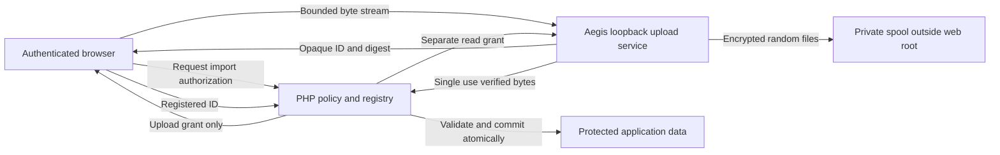

# Application and staging ownership

This contract describes application ownership for Aegis staging and the disposable local interoperability test. Deployment and application authorization are explicit operator decisions.

The application registry records subject, random upload ID, purpose, expiry and workflow state before issuing a grant. An incoming ID is checked against the current authenticated subject and expected workflow. It cannot select another account, purpose or path. The browser receives only the upload grant. PHP creates the read grant after ownership and current authorization checks; it never forwards a client supplied read ticket. Separate grants do not turn an opaque ID into a download link.

The spool path is owned only by local service configuration. Aegis never accepts it from headers, JSON, form fields, filenames, URLs or tickets. The PHP adapter does not know or open that path. Both sides know the logical object contract, while only Aegis knows the physical location. Do not add nginx alias, try_files, static hosting, PHP file serving or public GET routes for staging. No unguessability assumption replaces authorization.

The reference PHP adapter registers no routes or autoload hooks. The smoke test supplies only temporary loopback configuration and a disposable signing key. An integrating application must decide registration storage, fresh step up, CSRF, revocation and cancellation behavior before using it. The adapter's public method arguments must come from verified session and registry objects, not raw GET or POST fields.

The upload route can be proxied to Aegis without passing bytes through PHP. The retrieval route must remain local. Strip forwarded identity and rewrite headers rather than treating proxy assertions as policy. Any origin allowlist comes from local configuration. Staging rejects content encodings, multipart bodies and HTTP trailers. Proxy mode separately supports multipart text fields and converts them to URL encoded forms. Binary content remains opaque and requires separate quarantined parsing if needed later.

Aegis has no application database access, domain encryption key, shell execution endpoint or automatic business commit. Aegis validation is syntactic and bounded. PHP must still enforce semantic schemas, row and numeric rules, ownership, required encrypted envelopes and an atomic commit. Moving ingress does not establish correct downstream persistence or commit behavior.
